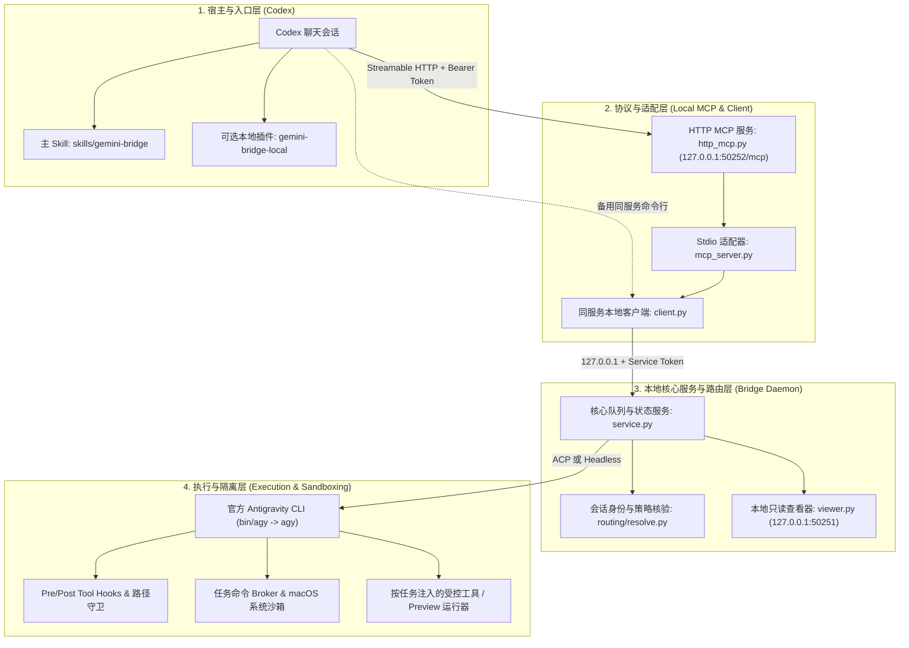

# 架构说明 (ARCHITECTURE)

本文档说明 Gemini Bridge（后端版本 `0.13.0`）的模块分层、进程与端口模型、数据流转、选模与身份核验机制，以及工作区隔离与协议兼容设计。

返回主页：[README.md](../README.md)

---

## 1. 四层总体架构

Gemini Bridge 采用本地四层架构，将“宿主交互与提示规范”、“MCP 协议传输”、“任务队列与策略裁决”以及“底层 CLI 执行与沙箱隔离”解耦：



### 各层职责说明
1. **宿主与入口层**：
   - `skills/gemini-bridge/SKILL.md` 及 `references/*.md` 为 Codex 提供分流判断、轻量契约构建、工具调用顺序和实质验收规范。
   - `plugins/gemini-bridge-local` 提供 `@Gemini Bridge` 界面入口与查看辅助，自身不携带独立 MCP 进程或凭据，直接复用 `gemini_bridge_http`。
2. **协议与适配层**：
   - `http_mcp.py`（由 `script/http_mcp_runtime.py` 管理，运行于仓库本地 `.venv-http`）在 `127.0.0.1:50252/mcp` 提供独立的 Streamable HTTP MCP 服务，并暴露原生只读详情面板工具（`bridge_native_panel`）。
   - `mcp_server.py` 定义工具 JSON Schema 与请求分发；`http_mcp.py` 在独立工作线程与 `anyio.CancelScope(shield=True)` 中调用适配器，确保缓慢的预检或前端观察断开不会意外取消已提交的后台生成任务。
   - `client.py` 是连接同一本地后台守护进程（`service.py`）的受控客户端，既被 MCP 适配器内部复用，也可在宿主工具目录尚未刷新或连接中断时作为本地命令行备用入口。
3. **本地核心服务与路由层**：
   - `service.py` 维护单 worker 任务队列、scope 授权状态、请求幂等记录（`request_id`）、逻辑任务重试链、事件驱动等待计时与文件快照回收。
   - `routing/resolve.py` 通过只读方式核验当前 Codex 会话的真实运行上下文，结合 `routing/policy.json` 与 `model-routing.json` 计算模型资格。
   - `viewer.py` 在 `127.0.0.1:50251` 提供本地只读详情页，展示任务指令、模型证据、实时进度、回收文件与验收记录。
4. **执行与隔离层**：
   - 调用用户已安装并登录的官方 `agy` CLI（通过 `bin/agy` 符号链接）。
   - 通过 ACP（Agent Client Protocol）或 Headless 流式 JSON 模式驱动 CLI，并利用前置/后置工具 Hook、路径边界检查与命令 Broker 实施最小权限控制。

---

## 2. 会话身份核验与动态路由机制

### 2.1 只读会话身份核验（`routing/resolve.py`）
为了防止在非活动回合、未知主模型或伪造上下文中误触发外部调用，`routing/resolve.py` 在开启 scope 和执行任务前会执行以下只读核验：
1. 在 `<codex-home>`（默认 `~/.codex`）中定位最新的 `state_<N>.sqlite` 数据库，以只读 URI（`?mode=ro`）查询 `threads` 表中当前 `thread_id` 对应的 `rollout_path`。
2. 校验该日志路径必须位于 `<codex-home>/sessions/` 下、不是符号链接且文件名严格匹配 `<thread_id>`。
3. 解析会话 JSONL 日志中的 `session_meta`、`task_started` 与最新 `turn_context`，确认当前处于活动回合，并提取当前主模型与推理档位。
4. 若日志索引正在轮转或落盘未完成，仅进行有限次短暂重读，绝不回退读取旧日志文件或凭猜测放行。

### 2.2 三重选模决策（实时目录 × 显式策略 × 任务偏好）
Bridge 的选模由以下三部分共同决定：
1. **实时目录（`bridge_models`）**：调用 `agy models` 获取当前账号实时可用的模型列表（按账户、CLI 与网络身份最多复用 15 秒新鲜观测，失败立即失效，绝不使用过期缓存放行）。
2. **显式策略（`routing/policy.json`）**：
   - 核对主模型（`parents`）是否在禁派遣名单（`disabled_parent_models` / `disabled_parent_combinations`）中。
   - 普通外部候选模型需同时满足同版本 AA 基准下的能力与单任务成本双上限（`child_score <= parent_score AND child_task_cost <= parent_task_cost`）。
   - 若用户在安装时显式启用了 `external_subscription_exception` 或 `external_specialist_exception`（如采用示例策略时传入 `--subscription-exceptions`），则对列表中明确授权的精确 `model/effort` 组合按对应例外规则放行，但仍保留主模型身份核验与每次聊天的显式授权要求。
3. **任务复杂度与偏好（`model-routing.json` + `profile.json`）**：
   - 自动分发（`dispatch_mode="auto"`）在未显式指定模型时，按任务的 `kind`（`copy`、`english`、`extract`、`code-map`、`visual`、`prototype`、`image`）与 `task_complexity`（`routine`、`standard`、`complex`）从交集中挑选最优组合，并将完整候选原因记录在任务结果的 `model_selection` 字段中。
   - 手动默认配置保存在 `profile.json` 中；当用户或主 Agent 显式指定了 `model` 与 `effort` 时，不做静默替换，但仍执行策略与实时目录校验。

---

## 3. 传输通道（ACP vs. Headless）与工具兼容

### 3.1 自动通道选择（`transport="auto"`）
在 `v0.13.0` 中，`transport="auto"` 会按任务所需且已验证的能力自动选择底层执行通道：
- **ACP 通道**：优先用于普通材料任务与标准工作区任务（支持直接传递文本与图片、按任务注入 `project_tools` MCP、稳定会话 `cwd` 下的多轮续聊 `continue_job_id`、运行中纠正 `bridge_steer` 以及断线后 `session/load` 只读恢复 `bridge_recover`）。
- **Headless 通道**：用于启用了单层原生子任务（`subagents`: `reader` / `builder` / `reviewer`）的工作区以及生图任务（`kind="image"`），通过官方 `stream-json` 从 `stdin` 传入完整提示包。

### 3.2 原生文件工具兼容性（Antigravity CLI 1.5.3 跟进）
- 在 ACP 工作区模式下，官方 CLI 的原生文件工具调用会经过 Bridge 的 PreToolUse hook 进行路径与权限审查。
- 针对实际观察到的 Antigravity CLI `1.5.3` 原生读取工具调用形式 `read_file({"Path": "/absolute/path"})`，Bridge 已精确补充该别名兼容：同样执行现有的授权目录（`read_roots`）、受保护路径（`protected_paths`）与符号链接检查，并记录所读文件的 SHA-256 哈希。
- 其他未经核实的未知写入或修改工具别名仍默认拒绝；当模型侧原生写入别名不可用时，工作流支持在最终输出中返回结构化文件内容由主控 Codex 无损落盘验收。

---

## 4. 本地目录与运行时文件布局

配置并运行后，仓库目录的关键结构如下：

```text
gemini-bridge/
├── bin/
│   └── agy                       # 指向本机官方 agy 可执行文件的符号链接 (由 install.py 创建)
├── .venv-http/                   # 本地 HTTP MCP 专属 Python 虚拟环境 (由 install.py 创建)
├── .venv-preview/                # [可选] 页面预览与截图专属虚拟环境 (含 Playwright)
├── profile.json                  # 本地默认 model/effort/timeout 配置 (0600, 由 install.py 创建)
├── model-routing.json            # 任务复杂度、等待策略与模型族偏好定义
├── input-limits.json             # 通用安全输入工程预算限制
├── routing/
│   ├── resolve.py                # 只读会话身份与策略裁决器
│   ├── policy.example.json       # 带日期的示例策略模板 (2026-10-31.v11)
│   └── policy.json               # 本机生效的路由策略 (0600, 由 install.py 或用户创建)
├── script/
│   ├── install.py                # 本地环境、策略与 Skill 安装脚本
│   ├── connect_codex.py          # 启动 HTTP MCP 并写入 Codex config.toml 的连接脚本
│   ├── http_mcp_runtime.py       # 独立 HTTP MCP 进程管理 (start/ensure/status/stop/headers)
│   ├── restart_service.py        # 空闲状态安全重启 service.py 的维护脚本
│   └── check_cli_update.py       # 每日首次 CLI 版本更新检查脚本
├── skills/
│   └── gemini-bridge/            # 主 Skill 源码及 references/ 参考文档
├── plugins/
│   └── gemini-bridge-local/      # 本地 Codex 插件定义与图标资源
├── .runtime/                     # [私密 0700] 运行时状态、锁、日志与 Bearer Token (切勿提交或分享)
│   ├── service.json              # 核心队列守护进程发现文件与 Token
│   ├── http-mcp.json             # HTTP MCP 进程发现文件与 Token (0600)
│   └── catalog-diagnostics/      # 模型目录查询失败时的私密诊断记录
└── runs/                         # 各任务独立运行记录、快照、worktree、命令日志与交付物
    └── <job_id>/
        ├── inputs/               # 材料通道的只读输入快照
        ├── artifacts/            # 工作区任务的默认输出交付目录
        └── command-results/      # Broker 执行命令的受保护退出码与日志
```

关于安全隔离与权限边界的详细说明，请参阅 [安全与边界 (docs/SECURITY.md)](SECURITY.md)。
